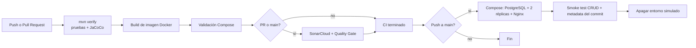

# Despacho — Microservicio de riesgo despacho

Repositorio de entrega de la EP2: <https://github.com/JeanU10/ms-despacho-ep2>.

Microservicio correspondiente al **caso caso10 — CargoClick** (Logística / courier) de la Evaluación Parcial N°1.

| | |
|---|---|
| Asignatura | JVY0101 — Java: Diseño y Construcción de Soluciones Nativas en Nube |
| Stack | Spring Boot 3.3 · Java 21 · Maven · Spring Data JPA · H2 local · PostgreSQL · Kubernetes |
| Calidad | JaCoCo cobertura LINE 100% · Cucumber (BDD) · SonarCloud · Trivy IaC |
| Observabilidad | Actuator/Micrometer · Prometheus · Grafana · Loki · Grafana Alloy |
| Entrega | Docker Compose para integración local · Kubernetes para despliegue orquestado |

## Responsabilidad (SRP)

Administra los datos y la lógica del dominio de Despacho del caso caso10 (CargoClick). Al ejecutarlo directamente usa H2 en memoria; Docker Compose conecta dos réplicas de la API a una base PostgreSQL compartida y persistente.

## Página de presentación

Al ejecutar el servicio, `http://localhost:8080/` muestra la página de presentación del microservicio con documentación y enlaces a:

- **Swagger UI**: `/swagger-ui/index.html`
- **OpenAPI (yaml)**: `/v3/api-docs.yaml`
- **ReDoc**: `/redoc.html`
- **H2 Console**: `/h2-console` (solo al ejecutar con el perfil local)

## Endpoints

| Método | Ruta | Descripción |
|--------|------|-------------|
| GET | `/api/despachos` | Lista todos los recursos |
| GET | `/api/despachos/{id}` | Obtiene un recurso por id |
| POST | `/api/despachos` | Crea un recurso |
| PUT | `/api/despachos/{id}` | Actualiza un recurso |
| DELETE | `/api/despachos/{id}` | Elimina un recurso |

## Documentación del proyecto

La documentación completa está en la carpeta [`docs/`](docs/):

- [`docs/00_Resumen.md`](docs/00_Resumen.md) — propósito, responsabilidad y tecnologías
- [`docs/01_Arquitectura.md`](docs/01_Arquitectura.md) — componentes, arquitectura y patrones
- [`docs/02_API.md`](docs/02_API.md) — contrato REST y ejemplos curl
- [`docs/03_Pruebas.md`](docs/03_Pruebas.md) — tests unitarios, cobertura y Cucumber
- [`docs/04_Despliegue.md`](docs/04_Despliegue.md)
- [`docs/05_Justificacion.md`](docs/05_Justificacion.md) — justificación del servicio: RF/RNF/seguridad cubiertos, stack y por qué cada tecnología AWS
- [`docs/06_Observabilidad_EP3.md`](docs/06_Observabilidad_EP3.md) — arquitectura, métricas, dashboard y controles de la EP3
- [`docs/07_Evidencia_EP3.md`](docs/07_Evidencia_EP3.md) — guía breve de validación y evidencia para la rúbrica
- [`docs/diagramas/`](docs/diagramas/) — C4 (contexto, contenedores, componentes), secuencia e infraestructura AWS — Docker, Docker Compose e integración

## Cómo ejecutar localmente

```bash
mvn spring-boot:run
```

La consola web de H2 queda desactivada por defecto. Para habilitarla solo en el entorno local:

```bash
mvn spring-boot:run -Dspring-boot.run.profiles=local
```

## Cómo ejecutar con Docker

```bash
Copy-Item .env.example .env
docker compose up --build --wait
# http://localhost:8080 (Nginx balancea las dos réplicas de la API)
docker compose ps
```

Compose guarda PostgreSQL en un volumen local. La contraseña predeterminada de `.env.example` sirve únicamente para desarrollo local; en otros entornos debe suministrarse una contraseña protegida mediante `POSTGRES_PASSWORD`.

Para levantar también el stack local de observabilidad:

```powershell
Copy-Item .env.example .env
docker compose --profile observability up --build --wait --scale despacho-svc=2
```

Grafana queda en `http://localhost:3000` (usuario `admin`; contraseña en `.env`), Prometheus en `http://localhost:9090` y Pushgateway en `http://localhost:9091`. Alloy lee los logs de contenedores Compose de este proyecto y los envía a Loki. El perfil es solo para desarrollo local: Alloy requiere acceso al socket de Docker. No expongas esos puertos fuera del equipo.

## Cómo ejecutar las pruebas

```bash
mvn test      # unit tests + Cucumber
mvn verify    # + verificación de cobertura JaCoCo (100% LINE, falla si baja)
```

## Pipeline CI/CD de la EP2

El workflow `.github/workflows/ci-cd.yml` se ejecuta en cada push y pull request. Primero ejecuta `mvn verify`, que corre las pruebas unitarias y Cucumber y aplica el umbral JaCoCo configurado en el proyecto; luego construye la imagen Docker optimizada y valida Compose. SonarQube Cloud analiza pull requests originados en este repositorio y los cambios de `main`, y el workflow espera el resultado de la Quality Gate. En pushes a otras ramas, las pruebas, la cobertura, la construcción y la validación de Compose siguen ejecutándose, pero se omite el análisis de rama: el plan configurado permite el análisis de PR y `main`, no el de ramas adicionales. Los pull requests desde forks también omiten SonarCloud porque GitHub no entrega secretos del repositorio a esos workflows. Si una etapa activa falla, el job queda bloqueado y no se ejecuta el despliegue.



En los pushes a `main` que superan esos pasos, GitHub Actions levanta en un runner hospedado por GitHub un entorno simulado con Nginx, dos réplicas de la API, PostgreSQL y el stack de observabilidad. Ejecuta un smoke test CRUD y un 404 controlado, publica duración de despliegue y cobertura en Pushgateway y confirma que Prometheus detecta la API y que Grafana cargó el dashboard. Guarda `deployment-metadata` y elimina el entorno al terminar. El job Kubernetes usa un runner efímero en el equipo de evaluación, publica una imagen etiquetada por SHA en ECR y despliega en EKS usando el perfil AWS local. Puede ejecutarse al actualizar `main` o manualmente con `deploy_kubernetes=true`.

Docker Compose aplica límites de CPU y memoria, ejecuta la aplicación como usuario no root, elimina capacidades Linux, impide la elevación de privilegios y usa healthchecks para la base de datos, las réplicas y el proxy. PostgreSQL permanece en una red interna y sus datos sobreviven a la recreación de los contenedores gracias al volumen nombrado. El endpoint Actuator no se publica por Nginx; Prometheus lo consulta desde la red interna.

### Extensión EP3: Kubernetes y gates de seguridad

Los manifiestos de `deploy/k8s/` despliegan PostgreSQL con volumen persistente, dos réplicas de la API, probes, límites de recursos, política de red, Prometheus, Pushgateway, Loki, Alloy y Grafana. La validación del workflow ejecuta Kustomize, Kubeconform y Trivy sobre los manifiestos. La Quality Gate de SonarCloud y el umbral JaCoCo siguen bloqueando los jobs de despliegue cuando fallan.

El job Kubernetes requiere los secretos `KUBE_DB_PASSWORD` y `GRAFANA_ADMIN_PASSWORD`. El runner efímero usa las credenciales AWS temporales del equipo y crea su kubeconfig en tiempo de ejecución; las claves AWS no se guardan en GitHub y los nodos leen la imagen privada de ECR con su rol IAM. Para desplegar desde esta rama, ejecuta manualmente `CI/CD` con `deploy_kubernetes=true`. Para demostrar el gate sin desplegar, ejecuta `CI/CD` con `simulate_critical_failure=true`: falla la etapa de calidad y el despliegue Kubernetes queda omitido.

La guía de despliegue, el dashboard y la matriz contra la rúbrica están en [`docs/06_Observabilidad_EP3.md`](docs/06_Observabilidad_EP3.md) y [`docs/07_Evidencia_EP3.md`](docs/07_Evidencia_EP3.md).

### Configuración de GitHub y SonarQube Cloud

La integración de este repositorio usa el secreto `SONAR_TOKEN` y las variables `SONAR_ORGANIZATION` y `SONAR_PROJECT_KEY`, configurados en **Settings → Secrets and variables → Actions**. La regla de `main` exige el check `Build, tests, coverage and SonarCloud` y una aprobación del pull request. Las alertas y actualizaciones de Dependabot están habilitadas; `.github/dependabot.yml` solicita actualizaciones semanales para Maven y GitHub Actions. Para replicar la integración en otra copia, primero impórtala en SonarQube Cloud y configura esos valores en los ajustes del repositorio.

Para cambiar el puerto publicado localmente, definir `HOST_PORT`; para identificar una construcción local, definir `IMAGE_TAG`. El workflow usa el SHA completo del commit como etiqueta.

## Declaración de uso de IA en esta entrega

Para la EP2 se utilizó OpenAI ChatGPT (Codex) como apoyo para revisar requisitos, proponer la configuración inicial de Docker, Docker Compose, GitHub Actions y Dependabot, y estructurar documentación. El equipo debe revisar y validar esos cambios.

Para la EP3 se utilizó OpenAI ChatGPT (Codex) como consultor técnico para identificar errores y proponer ajustes de implementación y configuración de monitoreo, Kubernetes y CI/CD. El equipo debe verificar el despliegue y la evidencia antes de entregar. Se cita el uso conforme a la [guía de IA de Biblioteca DUOC UC](https://bibliotecas.duoc.cl/ia).
