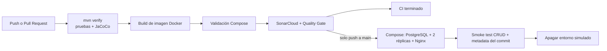

# Despacho — Microservicio de riesgo despacho

Repositorio de entrega de la EP2: <https://github.com/JeanU10/ms-despacho-ep2>.

Microservicio correspondiente al **caso caso10 — CargoClick** (Logística / courier) de la Evaluación Parcial N°1.

| | |
|---|---|
| Asignatura | JVY0101 — Java: Diseño y Construcción de Soluciones Nativas en Nube |
| Stack | Spring Boot 3.3 · Java 21 · Maven · Spring Data JPA · H2 local · PostgreSQL en Compose · springdoc-openapi |
| Calidad | JaCoCo cobertura LINE 100% · Cucumber (BDD) alineado a endpoints REST |
| Entrega | Docker / Docker Compose |

## Responsabilidad (SRP)

Administra los datos y la lógica del dominio de Despacho del caso caso10 (CargoClick). Al ejecutarlo directamente usa H2 en memoria; Docker Compose conecta dos réplicas de la API a una base PostgreSQL compartida y persistente.

## Página de presentación

Al ejecutar el servicio, `http://localhost:8080/` muestra la página de presentación del microservicio con documentación y enlaces a:

- **Swagger UI**: `/swagger-ui/index.html`
- **OpenAPI (yaml)**: `/v3/api-docs.yaml`
- **ReDoc**: `/redoc.html`
- **H2 Console**: `/h2-console` (solo al ejecutar con el perfil local)

## Endpoints

| Método | Ruta | Descripción |
|--------|------|-------------|
| GET | `/api/despachos` | Lista todos los recursos |
| GET | `/api/despachos/{id}` | Obtiene un recurso por id |
| POST | `/api/despachos` | Crea un recurso |
| PUT | `/api/despachos/{id}` | Actualiza un recurso |
| DELETE | `/api/despachos/{id}` | Elimina un recurso |

## Documentación del proyecto

La documentación completa está en la carpeta [`docs/`](docs/):

- [`docs/00_Resumen.md`](docs/00_Resumen.md) — propósito, responsabilidad y tecnologías
- [`docs/01_Arquitectura.md`](docs/01_Arquitectura.md) — componentes, arquitectura y patrones
- [`docs/02_API.md`](docs/02_API.md) — contrato REST y ejemplos curl
- [`docs/03_Pruebas.md`](docs/03_Pruebas.md) — tests unitarios, cobertura y Cucumber
- [`docs/04_Despliegue.md`](docs/04_Despliegue.md)
- [`docs/05_Justificacion.md`](docs/05_Justificacion.md) — justificación del servicio: RF/RNF/seguridad cubiertos, stack y por qué cada tecnología AWS
- [`docs/diagramas/`](docs/diagramas/) — C4 (contexto, contenedores, componentes), secuencia e infraestructura AWS — Docker, Docker Compose e integración

## Cómo ejecutar localmente

```bash
mvn spring-boot:run
```

La consola web de H2 queda desactivada por defecto. Para habilitarla solo en el entorno local:

```bash
mvn spring-boot:run -Dspring-boot.run.profiles=local
```

## Cómo ejecutar con Docker

```bash
Copy-Item .env.example .env
docker compose up --build --wait
# http://localhost:8080 (Nginx balancea las dos réplicas de la API)
docker compose ps
```

Compose guarda PostgreSQL en un volumen local. La contraseña predeterminada de `.env.example` sirve únicamente para desarrollo local; en otros entornos debe suministrarse una contraseña protegida mediante `POSTGRES_PASSWORD`.

## Cómo ejecutar las pruebas

```bash
mvn test      # unit tests + Cucumber
mvn verify    # + verificación de cobertura JaCoCo (100% LINE, falla si baja)
```

## Pipeline CI/CD de la EP2

El workflow `.github/workflows/ci-cd.yml` se ejecuta en cada push y pull request. Primero ejecuta `mvn verify`, que corre las pruebas unitarias y Cucumber y aplica el umbral JaCoCo configurado en el proyecto; luego construye la imagen Docker optimizada y valida Compose. Después envía el análisis a SonarQube Cloud y espera el resultado de la Quality Gate. Si las pruebas, la cobertura, la construcción o la Quality Gate fallan, el job queda bloqueado y no se ejecuta el despliegue.



En los pushes a `main` que superan esos pasos, GitHub Actions construye la imagen y levanta en el runner un entorno simulado con Nginx, dos réplicas de la API y PostgreSQL. El workflow usa una contraseña efímera, valida operaciones de lectura y escritura a través del proxy, guarda un artefacto `deployment-metadata` con el commit y la etiqueta usados y elimina el entorno al terminar. No publica una imagen en un registry ni deja un servicio alojado permanentemente.

Docker Compose aplica límites de CPU y memoria, ejecuta la aplicación como usuario no root, elimina capacidades Linux, impide la elevación de privilegios y usa healthchecks para la base de datos, las réplicas y el proxy. PostgreSQL permanece en una red interna y sus datos sobreviven a la recreación de los contenedores gracias al volumen nombrado.

### Configuración necesaria en GitHub

1. Importar este repositorio en SonarQube Cloud y crear un token con permiso para analizar el proyecto.
2. En **Settings → Secrets and variables → Actions**, crear el secreto `SONAR_TOKEN` y las variables de repositorio `SONAR_ORGANIZATION` y `SONAR_PROJECT_KEY` con los valores que entrega SonarQube Cloud.
3. En las reglas de protección de `main`, exigir el job de calidad de este workflow antes de permitir un merge.
4. Confirmar en **Settings → Security** que las alertas y actualizaciones de Dependabot estén habilitadas. `.github/dependabot.yml` solicita actualizaciones semanales para Maven y GitHub Actions.

Para cambiar el puerto publicado localmente, definir `HOST_PORT`; para identificar una construcción local, definir `IMAGE_TAG`. El workflow usa el SHA completo del commit como etiqueta.

## Declaración de uso de IA en esta entrega

Se utilizó OpenAI ChatGPT (Codex) como apoyo para revisar los requisitos de la EP2, proponer la configuración inicial de Docker, Docker Compose, GitHub Actions y Dependabot, y estructurar esta documentación. El equipo debe revisar y validar los cambios antes de entregar. En esta intervención no se redactaron conclusiones ni reflexiones individuales.
