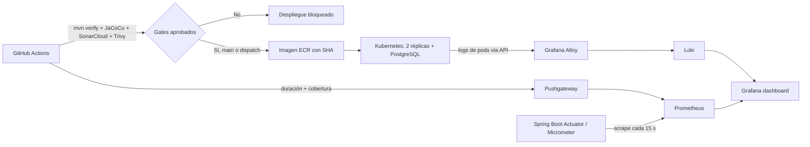

# EP3 — Observabilidad y entornos reales en DevOps

## Objetivo

Extender el pipeline de la EP2 para desplegar `ms-despacho` en Kubernetes, capturar métricas y logs, visualizar indicadores operativos y detener la entrega ante fallas de calidad o seguridad.

## Flujo de telemetría y despliegue

## Matriz de implementación

| Rúbrica | Implementación | Evidencia observable |
|---------|----------------|----------------------|
| **IE1 — Monitoreo (20%)** | Spring Boot Actuator/Micrometer expone métricas Prometheus. Prometheus raspa cada pod. Alloy lee los logs del namespace `despacho` mediante la API de Kubernetes y los envía a Loki. | Targets `despacho` en Prometheus; consultas de métricas; logs filtrables en Grafana/Loki. |
| **IE2 — Orquestación (20%)** | Kustomize crea namespace, StatefulSet de PostgreSQL con PVC, Deployment de API con dos réplicas, Service interno, probes, límites de CPU/memoria y rolling update. CI publica imagen con SHA y aplica el despliegue cuando el clúster está configurado. | Rollout de `despacho-svc`, pods listos, PVC enlazados y artefacto de despliegue. |
| **IE3 — Dashboard (10%)** | Grafana provisiona el dashboard `ms-despacho-ep3`: duración de despliegue, cobertura JaCoCo, disponibilidad, tasa de solicitudes, CPU de JVM, memoria de JVM, respuestas 4xx/5xx y logs con error. | `http://localhost:3000` en local; en Kubernetes usar `kubectl port-forward`. |
| **IE4 — Documentación (10%)** | Este documento resume el flujo, las decisiones y los indicadores. | Diagrama anterior, esta matriz y el historial/artefacto de CI. |
| **IE5 — Cumplimiento (20%)** | JaCoCo exige 100% de cobertura de línea; SonarCloud exige Quality Gate en PR/main; Trivy falla ante misconfigurations HIGH/CRITICAL; Kubernetes restringe el ingreso a PostgreSQL y el contenedor de la API corre sin root, sin capacidades y con filesystem de solo lectura. | Jobs de CI y salida de Trivy; manifiestos y política de red. La regla de protección de `main` permanece en Settings de GitHub y debe seguir exigiendo el check de calidad y aprobación. |
| **IE6 — Bloqueo crítico (20%)** | Todos los jobs de despliegue declaran `needs: quality`. Si falla `mvn verify`, JaCoCo, SonarCloud o Trivy, el job de despliegue no se ejecuta. El input manual `simulate_critical_failure=true` fuerza una falla controlada del gate. | Ejecución manual con gate fallido y jobs downstream saltados; no requiere modificar ni romper `main`. |

## Decisiones técnicas

- **Prometheus + Micrometer** separa la instrumentación de la aplicación del almacenamiento y permite observar cada pod. El endpoint `/actuator/prometheus` no queda publicado por Nginx; Prometheus accede al Service interno.
- **Loki + Alloy** complementa las series de tiempo con logs de contenedor. En Kubernetes Alloy tiene RBAC de solo lectura para pods, namespaces y `pods/log`; no recibe permiso para leer Secrets.
- **Pushgateway** recibe dos datos efímeros calculados por CI —duración del despliegue y cobertura de líneas— que una aplicación no puede exponer por sí misma. Prometheus los scrapea y Grafana los representa junto a las métricas de runtime.
- **Kubernetes Service** distribuye solicitudes entre dos réplicas. PostgreSQL queda dentro del clúster, con PVC y NetworkPolicy que limita conexiones al microservicio.
- **Gates en secuencia** mantienen las verificaciones de la EP2 y agregan validación de manifiestos y escaneo IaC antes de permitir el despliegue. Las imágenes y secretos no se versionan; la imagen se etiqueta por SHA para conservar trazabilidad.

## Indicadores del dashboard

| Indicador | Serie/consulta | Interpretación |
|-----------|----------------|----------------|
| Tiempo de despliegue | `ci_deployment_duration_seconds` | Segundos entre inicio de despliegue y rollout listo. |
| Cobertura | `ci_line_coverage_percent` | Porcentaje de líneas cubiertas reportado por JaCoCo. |
| Disponibilidad | `up{job="despacho"}` | `1` indica que Prometheus pudo scrapear el pod. |
| CPU | `100 * process_cpu_usage` | Uso de CPU del proceso JVM, en porcentaje. |
| Memoria | `jvm_memory_used_bytes` | Memoria de heap/non-heap de la JVM. |
| Errores HTTP | Respuestas `4xx` y `5xx` | Tasa de respuestas rechazadas o fallidas por estado HTTP. |
| Errores registrados | Logs Loki con `error`, `exception` o `fail` | Registros para investigar las fallas, no solo contarlas. |

Las métricas de CPU/memoria corresponden al proceso JVM; para producción conviene complementar con métricas de nodo y cAdvisor del clúster.

## Límites y configuración necesaria

El pipeline ejecuta de forma automática la simulación de Compose en `main`. El despliegue a EKS usa un runner efímero autohospedado en el equipo de evaluación y el perfil AWS local para obtener credenciales IAM; la imagen queda en ECR privado y el rol de los nodos la descarga. Solo requiere los secretos `KUBE_DB_PASSWORD` y `GRAFANA_ADMIN_PASSWORD`. En una rama de evaluación se puede activar manualmente con `deploy_kubernetes=true`.

El perfil local de Compose monta el socket de Docker para que Alloy pueda leer logs. Ese acceso concede control amplio sobre el motor local y se limita al perfil de demostración. En Kubernetes, Alloy usa la API con permisos de lectura.
